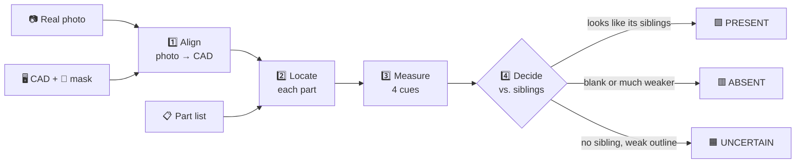
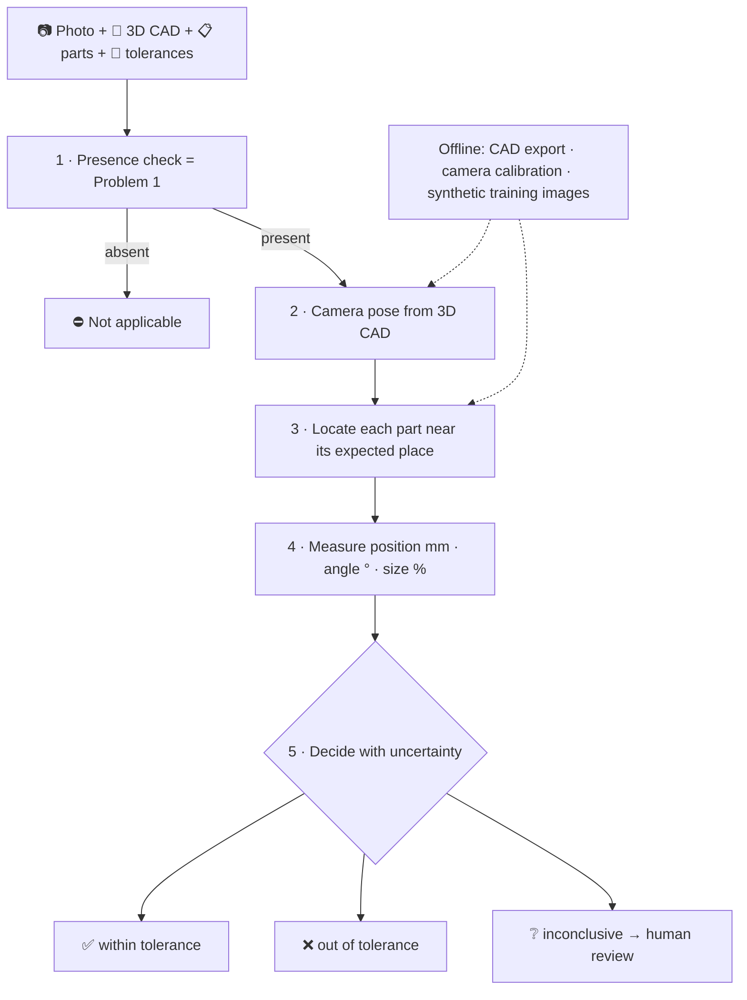
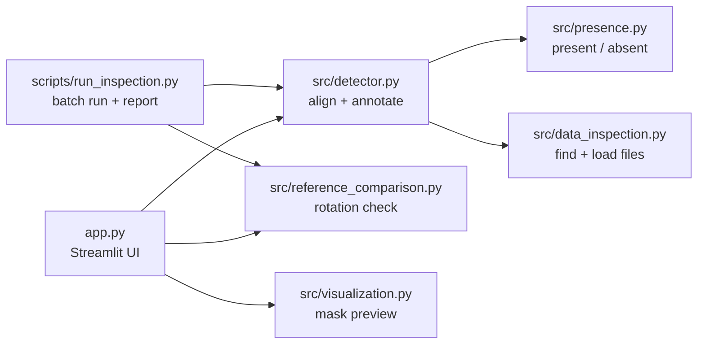

<div align="center">

# 🔍 PartSight

**Is every part really there?**
PartSight looks at a real photo of an assembly, compares it with the CAD design, and tells you which parts are present, which are missing, and which are rotated.


[The problem](#-the-problem) ·
[Quick start](#-quick-start) ·
[How it works](#-how-problem-1-is-solved) ·
[Results](#-results) ·
[Problem 2](#-problem-2-position-orientation-and-size) ·
[Code map](#-code-map) ·
[FAQ](#-faq)

</div>

---

## 🧩 The problem

A factory builds an assembly (a box with bolts, nuts and washers). Someone takes a photo of the finished product. We also have the CAD data that says what it *should* look like.

| | Question | What this repo delivers |
|---|---|---|
| **Problem 1** | For every part in the part list: is it **present** or **absent** in the photo? | ✅ Working code: a Streamlit app and a command-line script |
| **Problem 2** | For present parts: are they in the right **position**, at the right **angle**, with the right **size**? | 📐 A high-level architecture ([docs/problem2_architecture.md](docs/problem2_architecture.md)) |

Each case comes with four inputs:

```text
📷 Real photo          what was actually built            BG_00_TestImage.png
🖥️ CAD image           a rendering of the design          FG_00.png
🎨 Part-ID mask        each part painted with its own ID  Mask_00_00.bmp
📋 JSON part list      part name → ID in the mask         0000.json
```

> **The idea in one sentence:** the CAD image and mask are a *map* of where every part should be. We line the photo up with that map, go to each part's spot, and check whether something that looks like that part is there.

---

## 🚀 Quick start

```powershell
uv sync                                  # install dependencies
uv run streamlit run app.py              # open the app in your browser
```

Then, in the app:

1. Pick a **dataset case** and a **real photograph**.
2. *(Optional)* Keep `BG_00.png` as the **known-good photo** and tick the confirmation box to also detect **rotated** parts.
3. Click **Run Inspection**.

You get counts (Present / Rotated / Absent / Not visible / Uncertain), a table with the reason for every decision, the photo and CAD image with coloured outlines, and CSV/JSON downloads.

<details>
<summary><b>🖥️ Prefer the command line? Run every photo at once</b></summary>

```powershell
uv run python scripts/run_inspection.py
uv run python scripts/run_inspection.py --reference-photo BG_00.png --reference-confirmed   # + rotation check
```

| Option | Meaning |
|---|---|
| `--dataset-root <folder>` | Inspect another dataset (default `data/AI_sample_CAD`) |
| `--output <folder>` | Where to write results (default `outputs/inspection`) |
| `--reference-photo <file>` | Known-good photo in each case folder, for the rotation check |
| `--reference-confirmed` | Confirms that photo shows a complete assembly (required to use it) |

For each photo it writes `photo_annotated.png`, `cad_annotated.png`, `results.json` and `results.csv` to `<output>/presence/<case>/<photo>/`, then a scored `problem1_report.md`.

</details>

<details>
<summary><b>📁 Using your own data: supported file layouts</b></summary>

- **Sample layout:** one folder per case with `BG_*` real photos, an `FG_*` CAD image, one JSON (`{"<mask file>": [{"Name": ..., "StencilValue": ...}]}`) and the mask it names (or the folder's only `*mask*` file).
- **Assignment naming:** `<name>_Real.<ext>`, `<name>_CAD.<ext>`, `<name>_Mask.<ext>`, `<name>_PartNamesToPixelMap.json`. Several `<name>` sets can share one folder.

The JSON may also be a flat `{"<part name>": <pixel value>}` map or a list of parts. A pixel value is either a number (read from the mask channel that carries IDs) or an RGB colour `[r, g, b]` matched exactly in a colour mask.

Point the app's sidebar **Dataset folder** (or `--dataset-root`) at your folder.

</details>

---

## 🛠️ How Problem 1 is solved

No deep learning and no training data: just classic computer vision with OpenCV, so every decision is fast and explainable.



<details open>
<summary><b>1️⃣ Align: line the photo up with the CAD</b></summary>

A photo and a rendering have different colours, lighting and textures, but the **outlines** of the parts look alike. So we detect edges in both images, keep only those inside the assembly area (from the mask), and let OpenCV's `findTransformECC` find the perspective warp that makes the two sets of edges overlap.

If ECC fails, SIFT keypoint matching is tried as a fallback.

</details>

<details>
<summary><b>2️⃣ Locate: find where each part should be</b></summary>

Each part's pixels in the mask give its expected location. Only the largest connected piece is used, so stray boundary pixels are ignored.

A part with no pixels, or fewer than 400, in the CAD view is hidden behind other parts. It is reported as **NOT VISIBLE** and never guessed.

</details>

<details>
<summary><b>3️⃣ Measure: four cues at the part's spot</b></summary>

| Cue | Plain meaning |
|---|---|
| **Outline support** | Share of the part's CAD outline that is also an edge in the photo (within 3 px). The outline may slide ±16 px to absorb small alignment errors. |
| **Edge density** | How much edge detail is inside the region. A bolt has lots; a bare surface has little. |
| **Texture** | How much the brightness varies inside the region. |
| **Contrast** | How different the region is from a 20 px ring around it. |

</details>

<details>
<summary><b>4️⃣ Decide: compare each part with its siblings</b></summary>

Parts usually come in sets: `large_washer_1` … `large_washer_5`, `bolt_1`, `bolt_2` and so on. In the same photo, under the same light, identical parts should give similar cues. So instead of fixed thresholds, each part is compared with the **median of its same-type parts**:

```text
relative evidence = geometric mean of ( my cue / siblings' median cue )   over the 4 cues
                    1.0  → looks just like its siblings
                    < 0.6 → ABSENT
```

| Situation | Result |
|---|---|
| Region is blank (almost no texture and no edges) | 🟥 ABSENT |
| Relative evidence ≥ 0.6 | 🟩 PRESENT |
| Relative evidence < 0.6 | 🟥 ABSENT |
| No same-type part, ≥ 50% of the outline found | 🟩 PRESENT |
| No same-type part, < 50% of the outline found | 🟧 UNCERTAIN (we say so instead of guessing) |

> 🏫 **Analogy:** in a class photo you don't need to know each student's face. If one seat in a row of identical uniforms looks empty or very different, that student is missing. Comparing with siblings cancels out lighting and camera differences automatically.

</details>

<details>
<summary><b>🔄 Bonus: detect rotated parts</b></summary>

A rotated part is still **present**, but we want to show it is rotated. If you confirm a complete photo of the same assembly (e.g. `BG_00.png`), each present part is also compared with that photo, trying rotations in 5° steps and shifts up to ±24 px. A part that matches only after rotating is drawn in 🟦 **blue** as *Present (rotated)* with its angle.

Present/absent always comes from the CAD comparison; the known-good photo only adds rotation.

</details>

**Output colours:** 🟩 present · 🟥 absent (labelled `A`) · 🟦 rotated · 🟧 uncertain. Absent parts are outlined at their expected location on the photo.

---

## 📊 Results

On the sample data, scored against our visual labels of the deliberate defects:

<div align="center">

| Checked parts | ✅ Correct | ❌ Wrong | ❔ Uncertain |
|:---:|:---:|:---:|:---:|
| **64** | **64** | **0** | **0** |

</div>

| Photo | What was changed | PartSight says | Relative evidence |
|---|---|---|---|
| `BG_00` | nothing (reference) | 🟩 all 14 present | – |
| `BG_00_TestImage` | parts 10 and 24 removed | 🟥 10, 24 absent | – |
| `BG_00_TestImage2` | parts 10 and 24 rotated | 🟩 all present · 🟦 10, 24 rotated ≈70° clockwise | – |
| `BG_00_TestImage3` | part 25 (upper-left bolt/nut) removed | 🟥 25 absent | 0.51 |
| `TestCase2` | bolts 30 and 31 missing | 🟥 30, 31 absent | 0.40 / 0.37 |

> ⚠️ The labels are our own visual review, not official ground truth, and the thresholds were tuned on these few images. The app marks any decision within 0.15 of the 0.6 limit as *close to the decision limit*.

<details>
<summary><b>🤔 Why this approach? (and what we tried that didn't work)</b></summary>

| Option | Verdict |
|---|---|
| Keypoint matching (SIFT, LoFTR) to align photo and CAD | ❌ SIFT finds too few reliable matches between a photo and a rendering. LoFTR needed PyTorch and wasn't better than ECC. Removed; SIFT kept only as fallback. |
| **ECC on edges inside the mask** | ✅ Outlines are what photo and CAD share. Worked on every sample photo. |
| Fixed thresholds per cue | ❌ Values change with lighting, material and part size. |
| **Compare with same-type siblings** | ✅ Siblings share the lighting, so the comparison is fair by construction. |
| Compare only with a known-good photo | ➖ Needs such a photo from the same viewpoint. Kept as an optional extra for rotation. |
| Train a deep-learning detector | ➖ Needs many labelled images per product. Belongs in the Problem 2 design. |

</details>

<details>
<summary><b>🧗 Problems we hit and how we got past them</b></summary>

| Problem | Fix |
|---|---|
| Photo and CAD wouldn't align with keypoints | Switched to edge-based ECC inside the assembly mask |
| Fasteners sit at different heights, so one flat warp leaves them a few px off | Outline cue searches a ±16 px local shift |
| Stray pixels in the mask | Use only each part's largest connected piece |
| Parts hidden in the CAD view | Report *Not visible in CAD* instead of guessing |
| Missing part 25 was not caught by single cues | Combined-cue comparison with siblings (scores 0.51 → absent) |
| Are rotated parts absent? | Rule: rotated = present, flagged blue via the optional rotation check |
| Different file names and JSON shapes | Flexible loader for both layouts and all JSON shapes |
| Slow repeated runs | Cache the decoded CAD, mask and part regions |
| Cluttered app with experiments | Removed method selectors, alignment tabs, geometry tab and dead code |

</details>

<details>
<summary><b>🚧 Known limits</b></summary>

- If **every** part of one type is missing, there is no sibling to compare with; the part falls back to outline support and may be *uncertain*.
- Parts hidden in the CAD view can't be checked.
- The photo must be taken from roughly the CAD viewpoint.
- Thresholds (0.6, 50%, 400 px) need validation on more labelled photos.

</details>

---

## 📐 Problem 2: position, orientation and size

Problem 1 asks *"is it there?"*. Problem 2 asks *"is it in the right place, the right way round, the right size?"*. Answering in **millimetres** needs a 3D approach. This is a design, not code.



<details>
<summary><b>Why this design? Lessons from our 2D prototype</b></summary>

We first built a 2D geometry prototype on the sample photos (no longer in the code). Its failures shaped the design:

| What we saw | So the design does this |
|---|---|
| One flat 2D alignment left 5–20 px errors at fasteners | Use a **3D camera pose** |
| Fitting CAD outlines to photo edges couldn't pin down rotation or size | **Find the real part** with a detector trained on CAD renders, then render-and-compare |
| Round washers look the same at any rotation | Report rotation as **not observable** for symmetric parts |
| Values near the tolerance flipped between pass and fail | Decide with an **uncertainty range**, allow *inconclusive* |
| Measurements are in pixels | **Calibrate the camera** and use a scale reference for mm |

Full design, validation plan and risks: [docs/problem2_architecture.md](docs/problem2_architecture.md).

</details>

---

## 🗺️ Code map



| File | Role |
|---|---|
| [`src/presence.py`](src/presence.py) | 🧠 The decision: four cues, sibling comparison, reasons. Thresholds are constants at the top. |
| [`src/detector.py`](src/detector.py) | ⚙️ The pipeline: `inspect_case` loads a case, aligns (ECC → SIFT fallback), builds part regions, draws outlines, exports CSV/JSON. |
| [`src/data_inspection.py`](src/data_inspection.py) | 📁 Finds cases and photos in both layouts, reads any JSON shape, decodes the mask. |
| [`src/reference_comparison.py`](src/reference_comparison.py) | 🔄 Optional rotation check against a known-good photo. |
| [`src/visualization.py`](src/visualization.py) | 🎨 Colours the mask preview and builds the legend. |
| [`app.py`](app.py) | 🖥️ Streamlit app. |
| [`scripts/run_inspection.py`](scripts/run_inspection.py) | 🧾 Batch run over a dataset plus the scored report. |
| [`tests/`](tests) | 🧪 Unit tests (`uv run pytest -q`). |
| [`docs/problem2_architecture.md`](docs/problem2_architecture.md) | 📐 Problem 2 design. |

---

## ❓ FAQ

<details>
<summary><b>Does it use deep learning?</b></summary>

Not for Problem 1. It's classic computer vision (edges, ECC alignment, simple statistics): fast, explainable and no training data. The Problem 2 design uses a detector trained on synthetic CAD renders.
</details>

<details>
<summary><b>Why not just compare with the good photo BG_00?</b></summary>

You won't always have a good photo from the same viewpoint, but you always have the CAD. So presence comes from the CAD; BG_00 is only an optional extra for rotation.
</details>

<details>
<summary><b>What if the photo is bad?</b></summary>

If alignment fails, every part is reported *uncertain* with the reason. PartSight doesn't give confident answers from a bad alignment.
</details>

<details>
<summary><b>Why is a rotated part counted as present?</b></summary>

Problem 1 is about presence, and the part is there. A wrong angle is a geometry question (Problem 2), but it's still flagged blue so it isn't missed.
</details>

<details>
<summary><b>Installation troubles?</b></summary>

If a large wheel download is interrupted, retry with a longer timeout:

```powershell
$env:UV_HTTP_TIMEOUT = "120"
$env:UV_HTTP_RETRIES = "8"
uv sync
```

`pyproject.toml` is the authoritative dependency list; uv uses the ignored project-local `.uv-cache` folder.
</details>

---

<sub>The supplied masks decode as RGB `uint8` with part IDs in the red channel. Local data (`data/`) and generated outputs (`outputs/`) are ignored by Git, including `outputs/inspection/intended_defects.csv`, which holds the expected defects used to score results.</sub>
