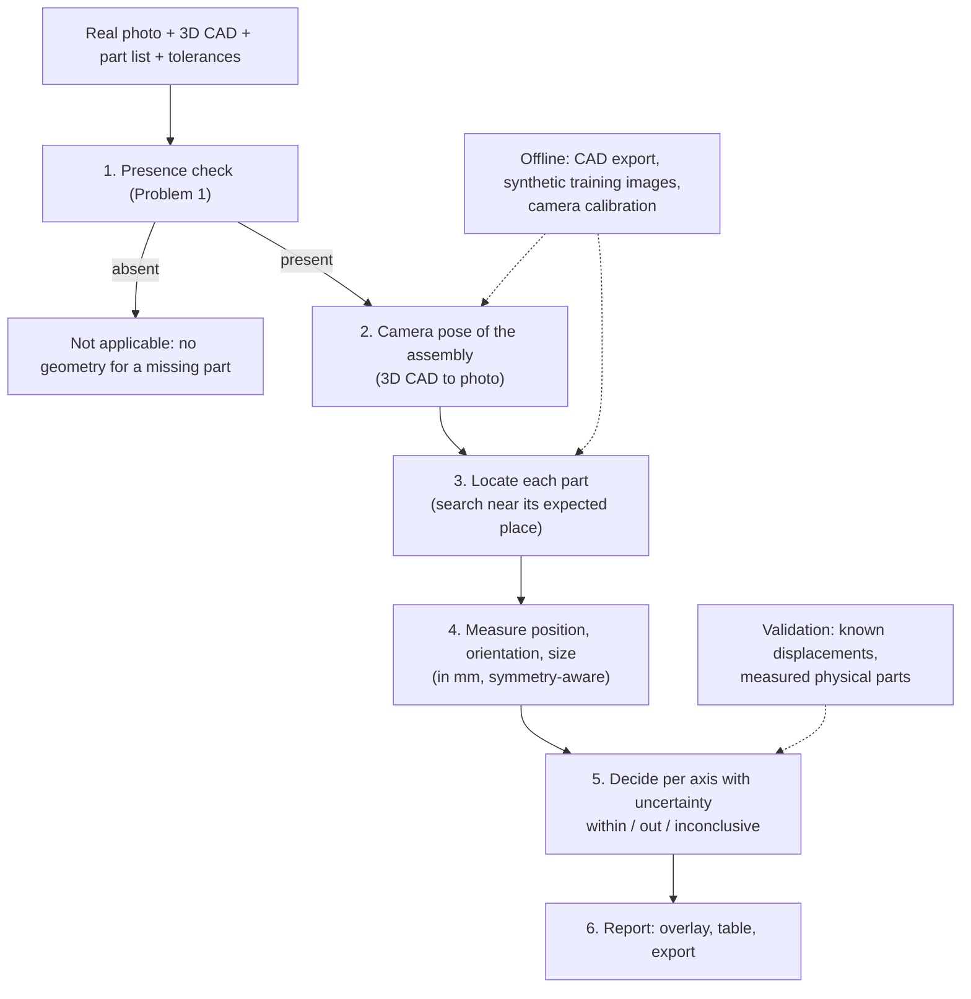

# Problem Statement 2: architecture for location and dimension checks

**Goal.** For every part that Problem 1 finds present, decide whether it is at the correct location (position and orientation) and has the correct dimensions compared with the CAD model, and show the result.

## Inputs and assumptions

| Input | Why it is needed |
|---|---|
| Real photo of the assembly | What is inspected |
| 3D CAD model with each part's nominal pose and key dimensions | The expected position, orientation, and size of every part, and the 3D shape needed to locate the camera |
| Part list and part-ID mask (as in Problem 1) | Which parts to check and where they appear |
| Tolerances per part (position mm, angle °, size %) | What counts as correct |
| Camera calibration (intrinsics, lens distortion) and a scale reference (marker or known dimension) | Converting image measurements to millimetres |

## Pipeline

| Stage | What it does | Output |
|---|---|---|
| **0. Offline preparation** | Export from the CAD each part's 3D shape, nominal pose, key dimensions, and tolerances. Calibrate the camera. Render many synthetic images of the assembly from the CAD (varied lighting, texture, viewpoint) to train the part detector. | Part database, calibrated camera, trained detector |
| **1. Presence** | Reuse the Problem 1 module. Absent parts skip geometry. | Present parts |
| **2. Camera pose** | Estimate where the camera was relative to the assembly (6 degrees of freedom), from matches between the photo and the 3D CAD (e.g. corners and edges of large rigid parts), then refine by rendering the CAD from that pose and aligning it with the photo. Reject the photo if the fit is poor. | Camera pose with a quality score |
| **3. Locate each part** | Project the part's expected position into the photo and search a small window around it. Find the actual part with a detector trained on the synthetic renders (instance segmentation or keypoints), and refine its pose by local render-and-compare. | Observed part pose in the image |
| **4. Measure** | Compare observed and expected pose in the assembly's 3D coordinates: position offset (mm), rotation (°), and size (visible lengths or diameters vs CAD). Rotation about a symmetry axis (a round washer) is reported as not observable. | Value per axis |
| **5. Decide** | Combine pose and detection uncertainty into a ± range per axis. Within tolerance only if the whole range is inside; out of tolerance only if the whole range is outside; otherwise inconclusive. | Per part: within tolerance, out of tolerance, not measurable, or not applicable |
| **6. Report** | Draw the expected outline and the observed part with an arrow for offsets, list values and decisions per part, and export CSV/JSON. Inconclusive parts go to a human review queue. | Annotated images and tables |

## Why these design choices (evidence from the prototype)

An earlier 2D prototype of stages 3–5 was run on the sample photos (it is no longer in the codebase). Its results shaped the design.

| Observation on the sample photos | Design consequence |
|---|---|
| A single 2D alignment of photo and CAD left 5–20 px errors at the fasteners, because they sit at different heights | Use a **3D camera pose** (stage 2), not a flat 2D alignment |
| Fitting the CAD outline to photo edges could not pin down rotation or size: rotation was ambiguous for every measured part, and most parts fitted best at the edge of the search range | **Find the real part** with a trained detector and render-and-compare (stage 3), instead of outline-to-edge fitting |
| Round parts (washers) look the same at any rotation | Report rotation as **not observable** for symmetric parts (stage 4) |
| Measurements near a tolerance limit flipped between pass and fail | Decide with an **uncertainty range** and allow "inconclusive" (stage 5) |
| Image measurements are in pixels | **Calibrate the camera** and use a scale reference to report millimetres (stage 0) |

## Validation plan

- **Synthetic tests:** render the CAD with parts deliberately moved, rotated, or resized by known amounts; check measured errors, false alarms on unchanged parts, and missed deviations.
- **Physical tests:** photograph real assemblies with parts displaced by measured amounts (calipers or a coordinate measuring machine) to confirm millimetre accuracy.
- **Uncertainty check:** the reported ± range should contain the true error for most parts; if not, recalibrate it.

## Limits and risks

- Hidden or heavily occluded parts cannot be measured; they are reported as not measurable.
- Accuracy depends on camera calibration and on the photo resembling the CAD viewpoint closely enough for pose estimation.
- The part detector needs synthetic training images per product; rendering and domain gaps (real lighting, reflections) must be checked on real photos.
- Very blurred, glare-heavy, or extreme-angle photos give inconclusive results rather than guesses.
